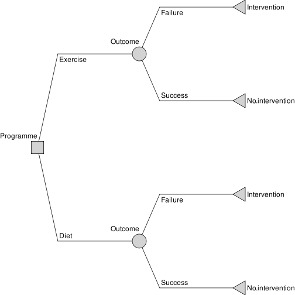
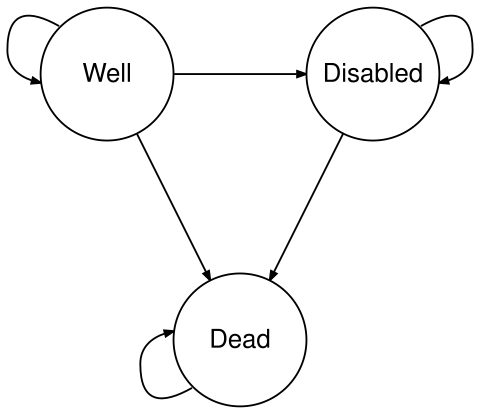

# rdecision

The goal of `rdecision` is to provide methods for assessing health care
interventions using cohort models (decision trees and semi-Markov
models) which can be constructed using only a few lines of R code.
Mechanisms are provided for associating an uncertainty distribution with
each source variable and for ensuring transparency of the mathematical
relationships between variables. The package terminology follows Briggs
*et al* “Decision Modelling for Health Economic Evaluation” (Briggs et
al. 2006).

## Installation

You can install the released version of rdecision from
[CRAN](https://CRAN.R-project.org) with:

    install.packages("rdecision")

## Examples

### A decision tree with parameter uncertainty

Consider the fictitious and idealized decision problem of choosing
between providing two forms of lifestyle advice, offered to people with
vascular disease, which reduce the risk of needing an interventional
procedure. It is assumed that the interventional procedure is the
insertion of a stent, that the current standard of care is the provision
of dietary advice, and that the new form of care is enrolment on an
exercise programme. To assess the decision problem, we construct a model
from the perspective of a healthcare provider, with a time horizon of
one year, and assume that the utility of both forms of advice is equal.
The model evaluates the incremental benefit of the exercise programme as
the incremental number of interventional procedures avoided against the
incremental cost of the exercise programme.

The cost to a healthcare provider of the interventional procedure (e.g.,
inserting a stent) is 5000 GBP; the cost of providing the current form
of lifestyle advice, an appointment with a dietician (“diet”), is 50 GBP
and the cost of providing an alternative form, attendance at an exercise
programme (“exercise”), is 750 GBP. None of the costs are subject to
uncertainty, and are modelled as constant model variables.

    cost_diet <- ConstModVar$new("Cost of diet programme", "GBP", 50.0)
    cost_exercise <- ConstModVar$new("Cost of exercise programme", "GBP", 750.0)
    cost_stent <- ConstModVar$new("Cost of stent intervention", "GBP", 5000.0)

If an advice programme is successful, there is no need for an
interventional procedure. In a small trial of the “diet” programme, 12
out of 68 patients (17.6%) avoided having a procedure, and in a separate
small trial of the “exercise” programme 18 out of 58 patients (31.0%)
avoided the procedure. It is assumed that the baseline characteristics
in the two trials were comparable. The trial results are represented as
scalar integers.

    s_diet <- 12L
    f_diet <- 56L
    s_exercise <- 18L
    f_exercise <- 40L

The proportions of the two programmes being successful (i.e., avoiding
an interventional procedure) are uncertain due to the finite size of
each trial and are represented by model variables with uncertainties
which follow Beta distributions.

    p_diet <- BetaModVar$new(
      alpha = s_diet, beta = f_diet, description = "P(diet)", units = ""
    )
    p_exercise <- BetaModVar$new(
      alpha = s_exercise, beta = f_exercise, description = "P(exercise)", units = ""
    )

The decision tree has one decision node, representing the single choice
of the decision problem (i.e., between the two advice programmes), two
chance nodes, representing whether each programme is a success or
failure, and four leaf nodes (intervention or no intervention for each
of the two programmes).

    decision_node <- DecisionNode$new("Programme")

    chance_node_diet <- ChanceNode$new("Outcome")
    chance_node_exercise <- ChanceNode$new("Outcome")

    leaf_node_diet_no_stent <- LeafNode$new("No intervention")
    leaf_node_diet_stent <- LeafNode$new("Intervention")
    leaf_node_exercise_no_stent <- LeafNode$new("No intervention")
    leaf_node_exercise_stent <- LeafNode$new("Intervention")

There are two action edges emanating from the decision node, which
represent the two choices, each with an associated cost.

    action_diet <- Action$new(
      decision_node, chance_node_diet, cost = cost_diet, label = "Diet"
    )
    action_exercise <- Action$new(
      decision_node, chance_node_exercise, cost = cost_exercise, label = "Exercise"
    )

There are four reaction edges, representing the consequences of the
success and failure of each programme. Edges representing success are
associated with the probability of programme success, and those
representing programme failure are assigned a probability of `NA` (to
ensure that the total probability associated with each chance node is
one) and a failure cost (of fitting a stent).

    reaction_diet_success <- Reaction$new(
      chance_node_diet, leaf_node_diet_no_stent,
      p = p_diet, cost = 0.0, label = "Success"
    )

    reaction_diet_failure <- Reaction$new(
      chance_node_diet, leaf_node_diet_stent,
      p = NA_real_, cost = cost_stent, label = "Failure"
    )

    reaction_exercise_success <- Reaction$new(
      chance_node_exercise, leaf_node_exercise_no_stent,
      p = p_exercise, cost = 0.0, label = "Success"
    )

    reaction_exercise_failure <- Reaction$new(
      chance_node_exercise, leaf_node_exercise_stent,
      p = NA_real_, cost = cost_stent, label = "Failure"
    )

The decision tree model is constructed from the nodes and edges.

    dt <- DecisionTree$new(
      V = list(
        decision_node,
        chance_node_diet,
        chance_node_exercise,
        leaf_node_diet_no_stent,
        leaf_node_diet_stent,
        leaf_node_exercise_no_stent,
        leaf_node_exercise_stent
      ),
      E = list(
        action_diet,
        action_exercise,
        reaction_diet_success,
        reaction_diet_failure,
        reaction_exercise_success,
        reaction_exercise_failure
      )
    )

A decision tree

The method `evaluate` is used to calculate the costs and utilities
associated with the decision problem. By default, it evaluates it once
with all the model variables set to their expected values and returns a
data frame.

    rs <- dt$evaluate()

Examination of the results of evaluation shows that the expected
per-patient net cost of the diet advice programme is 4,168 GBP and the
per-patient net cost of the exercise programme is 4,198 GBP; i.e., the
net cost of the exercise programme exceeds the diet programme by 31 GBP
per patient. The savings associated with the greater efficacy of the
exercise programme do not offset the increased cost of delivering it.

Because the probabilities of the success proportions of the two
treatments have been represented as model variables with an uncertainty
distribution, the uncertainty of the relative effectiveness is estimated
by repeated evaluation of the decision tree.

    N <- 1000L
    rs <- dt$evaluate(setvars = "random", by = "run", N = N)

The confidence interval of the net cost difference (net cost of the diet
programme minus the net cost of the exercise programme) is estimated
from the resulting data frame. From 1000 runs, the mean net cost
difference is -20.21 GBP with 95% confidence interval -753.6 GBP to
708.04 GBP, with 46.8% runs having a lower net cost for the exercise
programme. Although the point estimate net cost of the exercise
programme exceeds that of the diet programme, due to the uncertainties
of the effectiveness of each programme, it can be concluded that there
is insufficient evidence that the net costs differ.

The method `threshold` is used to find the threshold of one of the model
variables at which the cost difference reaches zero. By univariate
threshold analysis, the exercise program will be cost saving when its
cost of delivery is less than 719 GBP or when its success rate is
greater than 31.74%. These thresholds are also subject to uncertainty.

### A three-state Markov model

Sonnenberg and Beck (1993) introduced an illustrative example of a
semi-Markov process with three states: “Well”, “Disabled” and “Dead” and
one transition between each state, each with a per-cycle probability. In
`rdecision` such a model is constructed as follows. Note that
transitions from a state to itself must be specified if allowed,
otherwise the state would be a temporary state.

    # create states
    s.well <- MarkovState$new(name = "Well", utility = 1.0)
    s.disabled <- MarkovState$new(name = "Disabled", utility = 0.7)
    s.dead <- MarkovState$new(name = "Dead", utility = 0.0)

    # create transitions leaving rates undefined
    E <- list(
      Transition$new(s.well, s.well),
      Transition$new(s.dead, s.dead),
      Transition$new(s.disabled, s.disabled),
      Transition$new(s.well, s.disabled),
      Transition$new(s.well, s.dead),
      Transition$new(s.disabled, s.dead)
    )

    # create the model
    M <- SemiMarkovModel$new(V = list(s.well, s.disabled, s.dead), E)

    # create transition probability matrix
    snames <- c("Well", "Disabled", "Dead")
    Pt <- matrix(
      data = c(0.6, 0.2, 0.2, 0.0, 0.6, 0.4, 0.0, 0.0, 1.0),
      nrow = 3L, byrow = TRUE,
      dimnames = list(source = snames, target = snames)
    )
    # set the transition rates from per-cycle probabilities
    M$set_probabilities(Pt)

A three-state Markov model

With a starting population of 10,000, the model can be run for 24 years
as follows.

    # set the starting populations
    M$reset(c(Well = 10000.0, Disabled = 0.0, Dead = 0.0))
    # cycle
    MT <- M$cycles(24L, hcc.pop = FALSE, hcc.cost = FALSE, hcc.QALY = FALSE)

The output, after rounding, of the `cycles` function is the Markov
trace, shown below, which replicates Table 2 (Sonnenberg and Beck 1993).
In more recent usage, cumulative utility is normally called incremental
utility, and expressed per patient (i.e., divided by 10,000).

| Years |  Well | Disabled |  Dead | Cumulative Utility |
|------:|------:|---------:|------:|-------------------:|
|     0 | 10000 |        0 |     0 |                  0 |
|     1 |  6000 |     2000 |  2000 |               7400 |
|     2 |  3600 |     2400 |  4000 |              12680 |
|     3 |  2160 |     2160 |  5680 |              16352 |
|    23 |     0 |        1 |  9999 |              23749 |
|    24 |     0 |        0 | 10000 |              23749 |

## Acknowledgements

In addition to using base R (R Core Team 2025), `redecision` relies on
the `R6` implementation of classes (Chang 2025) and the `rlang` package
(Henry and Wickham 2026) for non-standard evaluation used in expression
model variables. Testing the package relies on the`testthat` package
(Wickham 2011). Preparing the package for building makes use of the
`devtools` package (Wickham et al. 2026). Building vignettes require
packages `rmarkdown` (Xie et al. 2018, 2020; Allaire et al. 2026),
`knitr` (Xie 2025) and `DiagrammeR` (Iannone and Roy 2026).

Underpinning graph theory is based on terminology, definitions and
algorithms from Gross *et al* (2013), the Wikipedia glossary (Wikipedia
2021) and links therein. Topological sorting of graphs is based on
Kahn’s algorithm (1962). Terminology for decision trees draws on the
work of Kaminski *et al* (2018) and an efficient tree drawing algorithm
was based on the work of Walker (1989). In semi-Markov models,
representations may be exported in the DOT (Gansner et al. 1993) and GML
(Himsolt 2010) languages.

Terminology for decision trees and Markov models in health economic
evaluation was based on the book by Briggs *et al* (2006) and the output
format and terminology follows ISPOR recommendations (Briggs et al.
2012; Siebert et al. 2012).

Citations for examples used in vignettes are given in applicable
vignette files.

## References

Allaire, JJ, Yihui Xie, Jonathan McPherson, et al. 2026. *Rmarkdown:
Dynamic Documents for r*. Released.
<https://github.com/rstudio/rmarkdown>.

Briggs, Andrew H., Milton C. Weinstein, Elisabeth A. L. Fenwick,
Jonathan Karnon, Mark J. Sculpher, and A. David Paltiel. 2012. “Model
Parameter Estimation and Uncertainty: A Report of the ISPOR-SMDM
Modeling Good Research Practices Task Force-6.” *Value in Health* 15
(6): 835–42. <https://doi.org/10.1016/j.jval.2012.04.014>.

Briggs, Andrew, Karl Claxton, and Mark Sculpher. 2006. *Decision
Modelling for Health Economic Evaluation*. Oxford University Press.

Chang, Winston. 2025. *R6: Encapsulated Classes with Reference
Semantics*. Released. <https://CRAN.R-project.org/package=R6>.

Gansner, E. R., E. Koutsofios, S. C. North, and K-P. Vo. 1993. “A
Technique for Drawing Directed Graphs.” *IEEE Transactions on Software
Engineering* 19 (3): 214–30. <https://doi.org/10.1109/32.221135>.

Gross, J. L., J. Yellen, and P. Zhang. 2013. *Handbook of Graph Theory*.
2nd ed. Chapman; Hall/CRC. <https://doi.org/10.1201/b16132>.

Henry, Lionel, and Hadley Wickham. 2026. *Rlang: Functions for Base
Types and Core r and Tidyverse Features*. Released.
<https://CRAN.R-project.org/package=rlang>.

Himsolt, Michael. 2010. “GML: A Portable Graph File Format.”
<https://api.semanticscholar.org/CorpusID:5806388>.

Iannone, Richard, and Olivier Roy. 2026. *DiagrammeR: Graph/Network
Visualization*. Released.
<https://doi.org/10.32614/CRAN.package.DiagrammeR>.

Kahn, A. B. 1962. “Topological Sorting of Large Networks.”
*Communications of the ACM* 5 (11): 558–62.
<https://doi.org/10.1145/368996.369025>.

Kamiński, Bogumil, Michal Jakubczyk, and Przemyslaw Szufel. 2018. “A
Framework for Sensitivity Analysis of Decision Trees.” *Central European
Journal of Operational Research* 26: 135–59.
<https://doi.org/10.1007/s10100-017-0479-6>.

R Core Team. 2025. *R: A Language and Environment for Statistical
Computing*. Vienna, Austria, Released. <https://www.R-project.org/>.

Siebert, Uwe, Oguzhan Alagoz, Ahmed M. Bayoumi, et al. 2012.
“State-Transition Modeling: A Report of the ISPOR-SMDM Modeling Good
Research Practices Task Force-3.” *Value in Health* 15 (6): 812–20.
<https://doi.org/10.1016/j.jval.2012.06.014>.

Sonnenberg, F. A., and J. R. Beck. 1993. “Markov Models in Medical
Decision Making: A Practical Guide.” *Medical Decision Making* 13 (4):
322–38. <https://doi.org/10.1177/0272989X9301300409>.

Walker, John Q. 1989. *A Node-Positioning Algorithm for General Trees*.
Technical Report TR 89-034. University of North Carolina.
<http://www.cs.unc.edu/techreports/89-034.pdf>.

Wickham, Hadley. 2011. “Testthat: Get Started with Testing.” *The R
Journal* 3: 5–10.
<https://journal.r-project.org/archive/2011-1/RJournal_2011-1_Wickham.pdf>.

Wickham, Hadley, Jim Hester, and Winston Chang. 2026. *Devtools: Tools
to Make Developing r Packages Easier*. Released.
<https://CRAN.R-project.org/package=devtools>.

Wikipedia. 2021. “Glossary of Graph Theory.” In *Wikipedia*.
<https://en.wikipedia.org/wiki/Glossary_of_graph_theory>.

Xie, Yihui. 2025. *Knitr: A General-Purpose Package for Dynamic Report
Generation in r*. V. R package version 1.51. Released.
<https://yihui.org/knitr/>.

Xie, Yihui, J. J. Allaire, and Garrett Grolemund. 2018. *R Markdown: The
Definitive Guide*. Chapman; Hall/CRC.
<https://bookdown.org/yihui/rmarkdown>.

Xie, Yihui, Christophe Dervieux, and Emily Riederer. 2020. *R Markdown
Cookbook*. Chapman; Hall/CRC.
<https://bookdown.org/yihui/rmarkdown-cookbook>.
